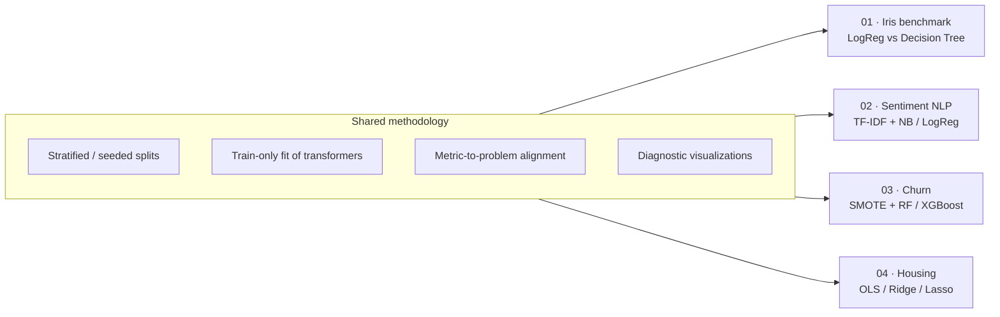
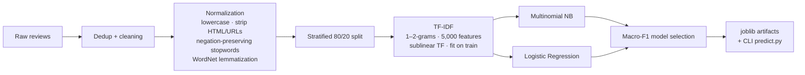
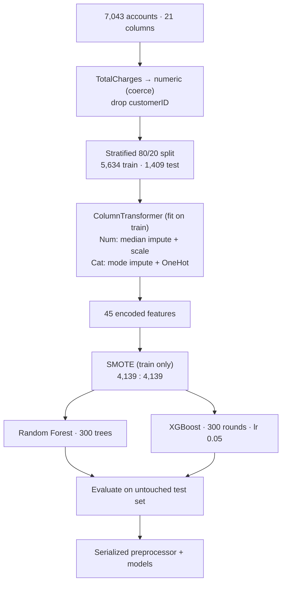

<div align="center">

# 🧠 Applied Machine Learning Portfolio

### Four end-to-end, reproducible ML systems spanning classification, NLP, imbalanced learning, and regularized regression

[](https://www.python.org/)
[](https://scikit-learn.org/)
[](https://xgboost.readthedocs.io/)
[](https://imbalanced-learn.org/)
[](https://www.nltk.org/)
[](https://jupyter.org/)
[](LICENSE)

</div>

---

## 📑 Table of Contents

1. [Overview](#-overview)
2. [Projects at a Glance](#-projects-at-a-glance)
3. [Repository Architecture](#-repository-architecture)
4. [Project 1 — Multi-Class Benchmark Pipeline (Iris)](#1--multi-class-benchmark-pipeline-iris)
5. [Project 2 — NLP Sentiment Classification (TF-IDF)](#2--nlp-sentiment-classification-tf-idf)
6. [Project 3 — Predictive Customer Churn Classifier](#3--predictive-customer-churn-classifier)
7. [Project 4 — California Housing Price Regression](#4--california-housing-price-regression)
8. [Cross-Project Engineering Principles](#-cross-project-engineering-principles)
9. [Technical Stack & Skills Demonstrated](#-technical-stack--skills-demonstrated)
10. [Getting Started](#-getting-started)
11. [Audit Notes & Known Limitations](#-audit-notes--known-limitations)
12. [Roadmap](#-roadmap)
13. [License](#-license)
14. [Author](#-author)

---

## 🎯 Overview

This repository consolidates four self-contained machine learning projects. Each one takes a different problem archetype from raw data to evaluated, interpretable results, and each one is built around the same standards:

- **Leakage-free evaluation.** Scalers, vectorizers, and encoders are fitted on training data only. Resampling touches only the training partition.
- **Metrics matched to the problem.** Macro-F1 for skewed multi-class text, ROC-AUC for churn ranking, and RMSE/MAE/R² for regression.
- **Diagnostics over headline numbers.** Confusion matrices, ROC curves, residual analysis, decision boundaries, and coefficient shrinkage plots are produced for every project.
- **Reproducibility.** Fixed seeds (`random_state=42`), pinned dependency floors, executed notebooks, and standalone scripts or serialized artifacts where applicable.
- **Candid reporting.** Limitations and caveats are documented in this README rather than hidden (see [Audit Notes](#-audit-notes--known-limitations)).

---

## 📊 Projects at a Glance

| # | Project | Problem Type | Dataset | Models | Headline Result |
|:-:|:--|:--|:--|:--|:--|
| 1 | [Multi-Class Benchmark Pipeline](#1--multi-class-benchmark-pipeline-iris) | Multi-class classification | Iris (150 × 4) | Logistic Regression, Decision Tree | **96.67 %** accuracy (Decision Tree) |
| 2 | [NLP Sentiment Classification](#2--nlp-sentiment-classification-tf-idf) | 3-class text classification (imbalanced) | HF `davidberg/sentiment-reviews` (3,458 usable reviews) | Multinomial NB, Logistic Regression | **≈ 80 %** accuracy, **≈ 0.59** macro-F1 (LR) |
| 3 | [Customer Churn Classifier](#3--predictive-customer-churn-classifier) | Binary classification (imbalanced) | IBM Telco Churn (7,043 × 21) | Random Forest, XGBoost + SMOTE | **0.835** test ROC-AUC (XGBoost) |
| 4 | [California Housing Regression](#4--california-housing-price-regression) | Continuous regression | California Housing (20,640 × 10) | OLS, Ridge, Lasso (GridSearchCV) | **R² 0.599**, RMSE **\$72.5k** (Lasso) |

---

## 🗂 Repository Architecture

```text
ml-portfolio/
├── README.md                                   # ← this document
├── LICENSE
│
├── 01-multiclass-benchmark-classification/
│   ├── multi_class_benchmark_pipeline.ipynb
│   ├── pipeline.py
│   ├── iris.csv
│   └── figures/                                # 6 diagnostic plots
│
├── 02-nlp-sentiment-classification/
│   ├── NLP_Sentiment_Classification_TFIDF.ipynb
│   ├── pipeline.py                             # train + evaluate + persist
│   ├── predict.py                              # CLI inference
│   ├── sentiment_classifier.joblib
│   ├── tfidf_vectorizer.joblib
│   ├── requirements.txt
│   └── assets/
│
├── 03-customer-churn-classifier/
│   ├── Predictive_Customer_Churn_Classifier.ipynb
│   ├── churn_preprocessor.pkl
│   ├── xgboost_churn.pkl
│   ├── random_forest_churn.pkl                 # ~42 MB — see Git LFS note
│   ├── requirements.txt
│   └── assets/
│
└── 04-california-housing-regression/
    ├── real_estate_house_prediction.ipynb
    ├── LICENSE
    └── assets/
```

> **Note:** The original project folders can be assembled into this layout with the script in [Getting Started](#-getting-started).



---

## 1 · 🌸 Multi-Class Benchmark Pipeline (Iris)

> A compact benchmarking harness that compares a linear probabilistic model against a non-linear rule-based model on a canonical multi-class problem, with emphasis on correct evaluation hygiene and interpretability.

### Objective
Benchmark **Multinomial Logistic Regression** (L-BFGS, L2, `C=1.0`) against a depth-regularized **Decision Tree** (CART, Gini, `max_depth=3`) on Fisher's Iris dataset (3 balanced classes, 4 continuous features).

### Methodology
1. Exploratory analysis: pairplot with KDE marginals and Pearson correlation matrix.
2. Stratified 80/20 split (120 train / 30 test, 10 samples per class in test).
3. `StandardScaler` fitted on the training set only, then applied to the test set.
4. Evaluation with accuracy, macro and weighted precision/recall/F1, confusion matrices, 2D decision surfaces (`petal_length` × `petal_width`), and the rendered tree structure.

### Results (held-out test set, n = 30)

| Metric | Logistic Regression | Decision Tree |
|:--|:-:|:-:|
| Accuracy | 0.9333 | **0.9667** |
| Macro Precision | 0.9333 | **0.9697** |
| Macro Recall | 0.9333 | **0.9667** |
| Macro F1 | 0.9333 | **0.9666** |

<div align="center">
  
  <br/><sub><b>Fig 1.</b> Side-by-side confusion matrices. Setosa is perfectly separated by both models; all errors occur between versicolor and virginica.</sub>
</div>

<br/>

<div align="center">
  
  <br/><sub><b>Fig 2.</b> Linear (smooth) versus axis-aligned (rectangular) decision surfaces.</sub>
</div>

### Key Takeaways
- `petal_length` and `petal_width` (r = 0.963) carry nearly all discriminative signal. Setosa is separable by a single threshold on `petal_length`.
- The 3.3-point gap between models equals **one test sample** (n = 30). It illustrates the models' differing inductive biases but is **not statistically significant**. See [Audit Notes](#-audit-notes--known-limitations).

**Run:** `python pipeline.py` (regenerates all figures) · **Notebook:** `multi_class_benchmark_pipeline.ipynb`

---

## 2 · 🌐 NLP Sentiment Classification (TF-IDF)

> An imbalanced three-class sentiment pipeline with negation-aware preprocessing, sublinear TF-IDF n-grams, a model benchmark, persisted artifacts, and a CLI inference tool.

<div align="center">
  
</div>

### Objective
Classify customer reviews as **positive / neutral / negative** and quantify how severe class imbalance (≈ 75 % positive) affects each classifier.

### Data
| Attribute | Value |
|:--|:--|
| Source | Hugging Face · `davidberg/sentiment-reviews` (`EcoPreprocessed.csv`) |
| Raw records | 4,084 (positive 3,066 · neutral 536 · negative 482) |
| After de-duplication | 3,467 |
| After normalization (usable) | 3,458 → 2,766 train / 692 test (stratified 80/20) |

### Pipeline


**Design decision: negation retention.** Standard stopword lists drop *not / no / never*, which turns "not good" into "good". The pipeline removes those tokens from the stopword set and preserves them, so bigrams such as *"not working"* survive vectorization.

### Results (held-out test set, n = 692)

| Model | Accuracy | Macro Precision | Macro Recall | Macro F1 |
|:--|:-:|:-:|:-:|:-:|
| **Logistic Regression** (selected) | **≈ 0.80** | **0.80** | **≈ 0.53–0.54** | **≈ 0.58–0.59** |
| Multinomial Naive Bayes (baseline) | 0.731 | 0.577 | 0.341 | 0.296 |

Per-class report for Logistic Regression (executed notebook):

| Class | Precision | Recall | F1 | Support |
|:--|:-:|:-:|:-:|:-:|
| negative | 0.87 | 0.42 | 0.57 | 92 |
| neutral | 0.73 | 0.20 | 0.31 | 96 |
| positive | 0.80 | 0.98 | 0.88 | 504 |

<div align="center">
  
  <br/><sub><b>Fig 3.</b> Most neutral reviews are absorbed into the positive class, which is the dominant failure mode.</sub>
</div>

### Key Takeaways
- Accuracy is misleading here because a majority-class predictor already scores about 75 %. **Macro-F1** is the selection criterion.
- Naive Bayes collapses toward the prior (macro-recall 0.34). Logistic Regression handles overlapping uni/bi-gram features far better.
- **Negative precision is high (0.87), but recall is low (0.42)**, so the model is conservative when flagging complaints. Neutral recall (0.20) is the weakest point.

### Inference
```bash
python predict.py "The customer support resolved my issue quickly and the product works flawlessly!"
python predict.py --interactive
```
Output includes the cleaned tokens, the predicted label, and a full per-class probability breakdown.

---

## 3 · 📡 Predictive Customer Churn Classifier

> A leakage-aware telecom churn model that uses SMOTE on the training fold only and compares Random Forest with XGBoost on a natural, un-resampled test distribution.

### Objective
Rank customers by churn risk on the **IBM Telco Customer Churn** dataset (7,043 accounts; 26.5 % churn) with a target of **ROC-AUC > 0.80**.

### Pipeline


### Model Configuration
| | Random Forest | XGBoost |
|:--|:--|:--|
| Estimators | 300 | 300 |
| Key regularization | `min_samples_split=5`, `min_samples_leaf=2` | `max_depth=5`, `learning_rate=0.05`, `subsample=0.8`, `colsample_bytree=0.8` |
| Seed | 42 | 42 |

### Results (held-out test set, n = 1,409: 1,035 stay / 374 churn)

| Metric | Random Forest | XGBoost |
|:--|:-:|:-:|
| **ROC-AUC** | 0.8311 | **0.8351** |
| Accuracy | 0.7771 | **0.7850** |
| Precision (churn) | 0.5732 | **0.5927** |
| Recall (churn) | **0.6283** | 0.6070 |
| F1 (churn) | 0.5995 | **0.5997** |

| Confusion matrix | TN | FP | FN | TP |
|:--|:-:|:-:|:-:|:-:|
| Random Forest | 860 | 175 | 139 | 235 |
| XGBoost | 879 | 156 | 147 | 227 |

<div align="center">
  
  
  <br/><sub><b>Fig 4–5.</b> ROC curves (both models exceed the 0.80 target) and top-10 feature importances.</sub>
</div>

### Key Takeaways
- **Contract type dominates.** `Contract_Month-to-month` accounts for ≈ 31 % of XGBoost's split gain.
- **Service gaps and billing signals matter.** No online security, no tech support, fiber-optic internet, and electronic-check payment all raise predicted risk.
- **Model trade-off.** XGBoost yields 19 fewer false positives (156 vs 175), which lowers wasted retention spend. Random Forest catches 8 more churners. Choose by the cost ratio of a missed churner versus an unnecessary offer.
- The README of the original project proposes retention levers such as contract migration, support bundling, fiber-optic onboarding checks, and autopay incentives. These are **hypotheses suggested by feature importance**, not causal estimates. Validate them with an A/B test before attributing ROI.

### Inference
```python
import joblib, pandas as pd

pre   = joblib.load("churn_preprocessor.pkl")
model = joblib.load("xgboost_churn.pkl")

customer = pd.DataFrame([{ "gender": "Female", "SeniorCitizen": 0, "Partner": "No",
    "Dependents": "No", "tenure": 2, "PhoneService": "Yes", "MultipleLines": "No",
    "InternetService": "Fiber optic", "OnlineSecurity": "No", "OnlineBackup": "No",
    "DeviceProtection": "No", "TechSupport": "No", "StreamingTV": "No",
    "StreamingMovies": "No", "Contract": "Month-to-month", "PaperlessBilling": "Yes",
    "PaymentMethod": "Electronic check", "MonthlyCharges": 70.70, "TotalCharges": 151.65 }])

p = model.predict_proba(pre.transform(customer))[0, 1]
print(f"Churn probability: {p:.1%}")
```

---

## 4 · 🏡 California Housing Price Regression

> A study of multicollinearity and regularization: OLS versus Ridge versus Lasso on census block-group data, with domain feature engineering and residual diagnostics.

### Objective
Predict `median_house_value` (censored at \$500k) for 20,640 California block groups, and quantify what L1/L2 regularization actually buys on a collinear feature set.

### Methodology
1. **Imputation:** 207 missing `total_bedrooms` values (1.0 %) filled with the median (435).
2. **Feature engineering:** `rooms_per_household`, `bedrooms_per_room`, `population_per_household` turn size-biased aggregates into density ratios.
3. **Collinearity diagnosis:** correlation heatmap; `total_bedrooms ↔ households` ρ ≈ 0.97, `total_rooms ↔ households` ρ ≈ 0.92, `population ↔ households` ρ ≈ 0.91.
4. **Encoding & scaling:** one-hot `ocean_proximity` (`drop_first=True`), `StandardScaler`, 80/20 split (16,512 / 4,128).
5. **Tuning:** 5-fold `GridSearchCV` over α ∈ {0.01, 0.1, 1, 10, 100, 500}, scored by negative MSE. Selected α = 10 (Ridge) and α = 100 (Lasso).

### Results (held-out test set, n = 4,128)

| Model | α | RMSE (\$) | MAE (\$) | R² |
|:--|:-:|:-:|:-:|:-:|
| **Lasso (L1)** | 100 | **72,522** | **50,832** | **0.5986** |
| Ridge (L2) | 10 | 72,648 | 50,886 | 0.5973 |
| OLS baseline | – | 72,669 | 50,889 | 0.5970 |

<div align="center">
  
  <br/><sub><b>Fig 6.</b> Predicted-vs-actual and residual distributions. The horizontal band at \$500k is the dataset's censoring artifact.</sub>
</div>

<br/>

<div align="center">
  
  <br/><sub><b>Fig 7.</b> Coefficient shrinkage across OLS, Ridge, and Lasso.</sub>
</div>

### Key Takeaways
- `median_income` is the dominant driver (≈ +\$79k per standard deviation). Location (`latitude`, `longitude`, `ocean_proximity_INLAND`) is the second strongest signal.
- Regularization gains are **tiny** (≈ \$146 RMSE, 0.2 %). With 16k training rows and 14 features, variance is already low, so OLS is competitive. The value of Ridge/Lasso here lies in **coefficient stability**, not accuracy.
- R² ≈ 0.60 reflects a **linear model ceiling**. Residuals show structure tied to the \$500k cap and to geographic non-linearity.

---

## 🛡 Cross-Project Engineering Principles

| Principle | Implementation |
|:--|:--|
| **No train/test leakage** | `fit` on train only for `StandardScaler`, `ColumnTransformer`, `TfidfVectorizer`; SMOTE applied to the training partition only |
| **Stratification** | Applied to all classification splits so test class ratios mirror the population |
| **Metric alignment** | Macro-F1 (NLP), ROC-AUC + per-class precision/recall (churn), RMSE/MAE/R² (regression), full report (Iris) |
| **Imbalance awareness** | Accuracy is explicitly de-emphasized where a majority baseline scores high |
| **Interpretability** | Tree rendering, feature importance, signed coefficients, and token-level inspection |
| **Reproducibility** | `random_state=42` throughout, executed notebooks, scripts that regenerate figures |
| **Deployability** | Serialized preprocessing + model pairs (`joblib`/`pkl`) and a CLI inference utility |

---

## 🧰 Technical Stack & Skills Demonstrated

| Area | Tools / Techniques |
|:--|:--|
| **Core** | Python · NumPy · pandas |
| **Modeling** | scikit-learn (Logistic/Ridge/Lasso, Decision Tree, Random Forest, Naive Bayes) · XGBoost |
| **Imbalanced learning** | imbalanced-learn (SMOTE) · stratified sampling |
| **NLP** | NLTK (WordNet lemmatization) · TF-IDF (n-grams, sublinear TF) · negation-aware stopword design |
| **Model selection** | `GridSearchCV` · hold-out evaluation · macro-averaged metrics · ROC-AUC |
| **Feature engineering** | ratio features · `ColumnTransformer` · one-hot encoding · median/mode imputation |
| **Diagnostics** | residual analysis · confusion matrices · decision boundaries · multicollinearity (correlation, VIF theory) |
| **Visualization** | matplotlib · seaborn |
| **Tooling** | Jupyter · joblib · Mermaid · Git |

---

## 🚀 Getting Started

### Prerequisites
- Python 3.10 or newer
- `git`, and optionally [Git LFS](https://git-lfs.com/) (see below)

### 1. Clone and create an environment
```bash
git clone https://github.com/<your-username>/ml-portfolio.git
cd ml-portfolio

python -m venv .venv
source .venv/bin/activate          # Windows: .venv\Scripts\activate
python -m pip install --upgrade pip
```

### 2. Install dependencies
Each project is independent, so install the stack you need:

```bash
# Projects 1 & 4
pip install numpy pandas scikit-learn matplotlib seaborn jupyterlab

# Project 2 (NLP)
pip install -r 02-nlp-sentiment-classification/requirements.txt

# Project 3 (Churn)
pip install -r 03-customer-churn-classifier/requirements.txt
```

### 3. Run each project
```bash
# 01 · Iris benchmark: regenerates every figure
cd 01-multiclass-benchmark-classification && python pipeline.py

# 02 · NLP: retrain (downloads data from Hugging Face), then predict
cd 02-nlp-sentiment-classification
python pipeline.py
python predict.py "Battery life is fantastic but the screen scratches too easily."

# 03 · Churn: open the executed notebook
jupyter lab 03-customer-churn-classifier/Predictive_Customer_Churn_Classifier.ipynb

# 04 · Housing: open the executed notebook
jupyter lab 04-california-housing-regression/real_estate_house_prediction.ipynb
```

### Assembling the monorepo from the original folders
```bash
mkdir ml-portfolio && cd ml-portfolio
mv ../multiclass_benchmark_classification_pineline  01-multiclass-benchmark-classification
mv ../NLP_sentiment_classifications                 02-nlp-sentiment-classification
mv "../Predictive Customer Churn Classifier"        03-customer-churn-classifier
mv ../Real_estate_house_prediction                  04-california-housing-regression
```

### Large files (Git LFS)
`random_forest_churn.pkl` is ≈ 42 MB. That is under GitHub's 100 MB hard limit but close to the 50 MB warning threshold, and it will bloat clone size on every retrain. Track it with LFS, or publish it as a Release asset:
```bash
git lfs install
git lfs track "*.pkl"
git add .gitattributes
```

> ⚠️ **Security note:** `pickle`/`joblib` files execute code on load. Only load artifacts from sources you trust.

---

## 🔎 Audit Notes & Known Limitations

Rigorous projects document their weaknesses. These points were identified while cross-checking the READMEs against the executed notebooks and code:

| Project | Observation | Recommended Action |
|:--|:--|:--|
| **01 · Iris** | n = 30 test samples, so a 1-sample difference moves accuracy 3.3 points. Model ranking is not statistically supported. | Use repeated stratified k-fold CV and report mean ± std; apply McNemar's test for paired comparison. |
| **02 · NLP** | The dataset (`EcoPreprocessed`) is already partially normalized. The executed notebook ran **without NLTK** (no lemmatization), while `pipeline.py` lemmatizes when NLTK is available, so metrics differ by roughly 1 point between the two paths (macro-F1 ≈ 0.58–0.59). A negative review ("disappointing… does not work properly") is misclassified as *neutral* in the demo. | Pin NLTK in the notebook environment; add `class_weight='balanced'`, threshold tuning, and a transformer baseline. |
| **03 · Churn** | The preprocessor and SMOTE are applied to the full training set. Any cross-validation run **on the SMOTE-resampled data** leaks synthetic neighbors across folds and overstates AUC (the original README quotes ≈ 0.93 CV vs 0.835 test). The notebook imports `StratifiedKFold` but contains no executed CV cell. Probabilities are also uncalibrated after SMOTE. | Use `imblearn.pipeline.Pipeline([... SMOTE, model])` inside `cross_val_score`; add calibration (`CalibratedClassifierCV`) and a cost-based threshold. The 0.835 hold-out AUC is the trustworthy figure. |
| **04 · Housing** | Lasso's advantage is ≈ 0.2 % RMSE, which is within noise. The split is random, and block groups are spatially autocorrelated. Target is censored at \$500k. | Use spatial/grouped CV, model the log-target, and benchmark tree ensembles. |
| **Repo hygiene** | The housing README references `build_notebook.py` and `requirements.txt`, which are absent from the supplied archive. The churn README links a `LICENSE` file that is not included. Folder name `Predictive Customer Churn Classifier` contains spaces. | Add the missing files or remove the references; use kebab-case folder names (as in the layout above). |

---

## 🗺 Roadmap

- [ ] **Unified evaluation harness:** repeated stratified CV with confidence intervals across all classification projects
- [ ] **Leak-proof imbalance handling:** `imblearn` pipelines inside CV, plus probability calibration and cost-sensitive thresholds for churn
- [ ] **Hyperparameter optimization:** Optuna for XGBoost/Random Forest; learning-rate × estimator sweeps
- [ ] **Explainability:** SHAP summaries for churn and token attributions for sentiment
- [ ] **Stronger text model:** fine-tuned DistilBERT/RoBERTa versus the TF-IDF baseline, with class-weighted loss
- [ ] **Regression upgrade:** gradient boosting and spatial cross-validation on log-transformed prices
- [ ] **Serving:** FastAPI microservice + Docker for the sentiment and churn models
- [ ] **CI/CD:** GitHub Actions for linting (`ruff`), notebook execution (`nbmake`), and unit tests (`pytest`)
- [ ] **Experiment tracking:** MLflow or Weights & Biases

---

## 📄 License

Distributed under the **MIT License**. See [`LICENSE`](LICENSE) for details.

**Data sources & acknowledgments**
- Iris: Fisher, R. A. (1936), *The use of multiple measurements in taxonomic problems*.
- Sentiment: [Hugging Face · `davidberg/sentiment-reviews`](https://huggingface.co/datasets/davidberg/sentiment-reviews).
- Churn: IBM Telco Customer Churn sample dataset.
- Housing: 1990 U.S. Census block groups via the [Hands-On Machine Learning repository](https://github.com/ageron/handson-ml2).

---

## 👤 Author

**Your Name**
Machine Learning & Data Science
[LinkedIn](https://linkedin.com/in/your-profile) · [GitHub](https://github.com/your-username) · [Email](mailto:you@example.com)

<div align="center">

⭐ If you found this portfolio useful, consider starring the repository.

</div>
