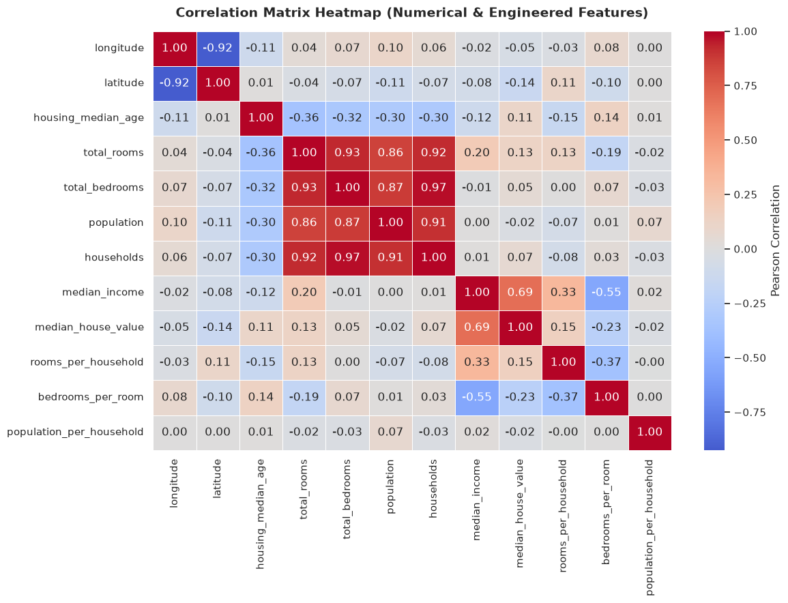
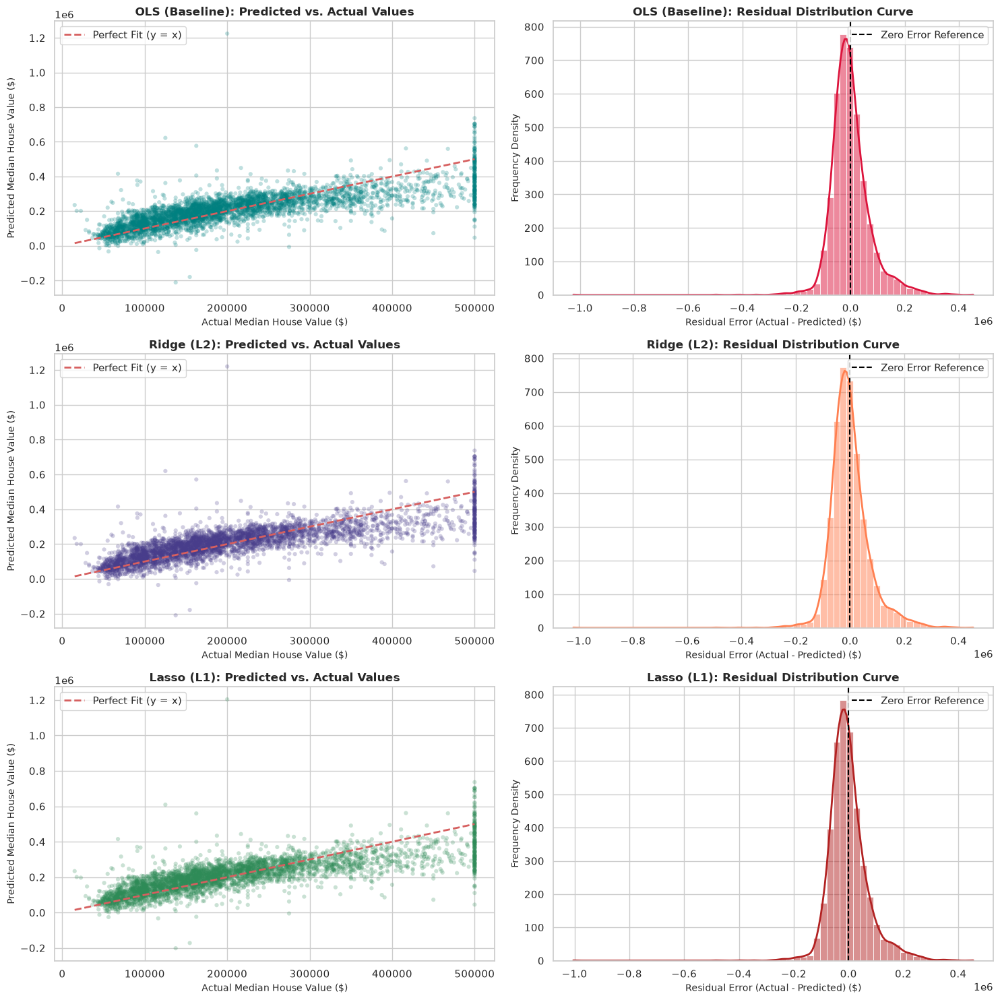
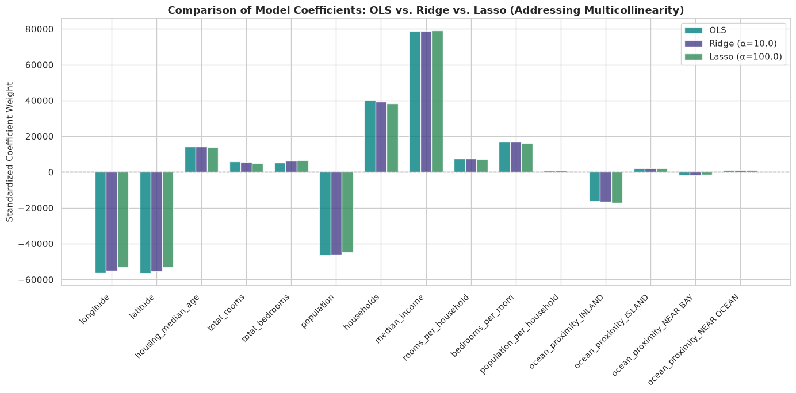

# 🏡 California Real Estate Housing Price Prediction
### Advanced Continuous Regression Modeling, Regularization ($L_1$ / $L_2$), Feature Engineering, and Residual Error Diagnostics

[](https://www.python.org/)
[](https://scikit-learn.org/)
[](https://pandas.pydata.org/)
[](https://numpy.org/)
[](https://jupyter.org/)
[](https://opensource.org/licenses/MIT)

---

## 📋 Table of Contents
- [Project Overview](#-project-overview)
- [System Architecture & ML Pipeline](#-system-architecture--ml-pipeline)
- [Mathematical Foundations](#-mathematical-foundations)
  - [Ordinary Least Squares (OLS)](#1-ordinary-least-squares-ols)
  - [Ridge Regression ($L_2$ Regularization)](#2-ridge-regression-l_2-regularization)
  - [Lasso Regression ($L_1$ Regularization)](#3-lasso-regression-l_1-regularization)
  - [The Problem of Multicollinearity](#4-the-problem-of-multicollinearity)
- [Dataset & Exploratory Analysis](#-dataset--exploratory-analysis)
  - [Data Ingestion](#data-ingestion)
  - [Missing Value Imputation](#missing-value-imputation)
- [Domain-Specific Feature Engineering](#-domain-specific-feature-engineering)
- [Multicollinearity Diagnosis & Correlation Heatmap](#-multicollinearity-diagnosis--correlation-heatmap)
- [Data Preprocessing & Scaling Pipeline](#-data-preprocessing--scaling-pipeline)
- [Hyperparameter Optimization via 5-Fold GridSearchCV](#-hyperparameter-optimization-via-5-fold-gridsearchcv)
- [Benchmark Performance & Metric Comparison](#-benchmark-performance--metric-comparison)
- [Diagnostic Residual Error Analysis](#-diagnostic-residual-error-analysis)
- [Feature Coefficients & Regularization Shrinkage](#-feature-coefficients--regularization-shrinkage)
- [Key Insights & Engineering Takeaways](#-key-insights--engineering-takeaways)
- [Repository Structure](#-repository-structure)
- [Installation & Quickstart Guide](#-installation--quickstart-guide)
- [License & Acknowledgments](#-license--acknowledgments)

---

## 🎯 Project Overview

In residential real estate valuation, accurate price forecasting is complicated by strong non-linear interactions, regional clustering, and **severe multicollinearity** among district demographic indicators (e.g., population count, room counts, and household totals). When multiple collinear features are fed into standard parametric models like Ordinary Least Squares (OLS), the parameter covariance matrix degenerates, causing wild coefficient volatility and poor generalization.

This project implements a rigorous, production-grade statistical machine learning workflow using the canonical **California Housing dataset** ($n = 20,640$ census block groups). We engineer contextual interaction terms, impute data with median statistical robustness, evaluate feature collinearity, and rigorously benchmark:
1. **Ordinary Least Squares (OLS) Regression** (Unregularized Baseline)
2. **Ridge Regression ($L_2$ Regularization)** (Coefficient Shrinkage)
3. **Lasso Regression ($L_1$ Regularization)** (Sparse Feature Selection)

All models are tuned using **5-Fold Cross-Validation (`GridSearchCV`)** and thoroughly analyzed through quantitative loss metrics ($\text{RMSE}$, $\text{MAE}$, $R^2$) and qualitative residual diagnostics.

---

## 🏗 System Architecture & ML Pipeline

The end-to-end regression modeling and diagnostic framework is organized into modular phases:

```mermaid
flowchart TD
    A[Raw California Housing Data<br/>20,640 Records | 10 Attributes] --> B[Data Inspection & Schema Validation]
    B --> C[Imputation Engine<br/>Median Imputation on total_bedrooms]
    C --> D[Feature Engineering<br/>rooms_per_household | bedrooms_per_room | population_per_household]
    D --> E[Multicollinearity Diagnostics<br/>Pearson Correlation Heatmap]
    E --> F[Categorical Encoding<br/>One-Hot Encoding on ocean_proximity]
    F --> G[Data Partitioning<br/>80% Train | 20% Test]
    G --> H[StandardScaler<br/>Zero Mean | Unit Variance]
    H --> I1[Baseline OLS Fit]
    H --> I2[Ridge GridSearchCV<br/>5-Fold CV across alpha grid]
    H --> I3[Lasso GridSearchCV<br/>5-Fold CV across alpha grid]
    I1 --> J[Comprehensive Evaluation<br/>RMSE | MAE | R² Score]
    I2 --> J
    I3 --> J
    J --> K[Residual Diagnostics<br/>Predicted vs Actual & Residual KDE Curves]
    J --> L[Coefficient Shrinkage Analysis<br/>OLS vs Ridge vs Lasso Weights]
```

---

## 📐 Mathematical Foundations

### 1. Ordinary Least Squares (OLS)
Ordinary Least Squares aims to find coefficient vector $\beta \in \mathbb{R}^p$ minimizing the residual sum of squares:

$$\min_{\beta} \mathcal{L}_{\text{OLS}}(\beta) = \|y - X\beta\|_2^2 = \sum_{i=1}^n \left(y_i - x_i^T\beta\right)^2$$

Assuming $X^T X$ is non-singular, the closed-form normal equation yields:

$$\hat{\beta}_{\text{OLS}} = (X^T X)^{-1} X^T y$$

Under the Gauss-Markov theorem, OLS provides the Best Linear Unbiased Estimator (BLUE). However, when features exhibit high multicollinearity, $X^T X$ approaches singularity ($\det(X^T X) \approx 0$), causing the variance of coefficients to explode:

$$\text{Var}(\hat{\beta}_j) = \sigma^2 \left[(X^T X)^{-1}\right]_{jj} = \frac{\sigma^2}{(n-1) s_j^2} \cdot \frac{1}{1 - R_j^2} = \frac{\sigma^2}{(n-1) s_j^2} \cdot \text{VIF}_j$$

Where $\text{VIF}_j$ is the **Variance Inflation Factor**.

---

### 2. Ridge Regression ($L_2$ Regularization)
Ridge regression introduces an $L_2$ Euclidean norm penalty on the weight vector to condition the inverse problem:

$$\min_{\beta} \mathcal{L}_{\text{Ridge}}(\beta) = \|y - X\beta\|_2^2 + \alpha \|\beta\|_2^2 = \sum_{i=1}^n \left(y_i - x_i^T\beta\right)^2 + \alpha \sum_{j=1}^p \beta_j^2$$

The closed-form analytical solution is:

$$\hat{\beta}_{\text{Ridge}} = (X^T X + \alpha I)^{-1} X^T y$$

#### Mathematical Significance:
- By adding $\alpha I$ to the diagonal of $X^T X$, all singular values $\lambda_j$ become $\lambda_j + \alpha > 0$, guaranteeing strict positive-definiteness and numerical stability.
- Ridge shrinks coefficients proportionally across collinear groups, dramatically reducing estimator variance at the cost of a small, controllable bias.

---

### 3. Lasso Regression ($L_1$ Regularization)
Lasso (Least Absolute Shrinkage and Selection Operator) applies an $L_1$ penalty:

$$\min_{\beta} \mathcal{L}_{\text{Lasso}}(\beta) = \frac{1}{2n} \|y - X\beta\|_2^2 + \alpha \|\beta\|_1 = \frac{1}{2n} \sum_{i=1}^n \left(y_i - x_i^T\beta\right)^2 + \alpha \sum_{j=1}^p |\beta_j|$$

Because the $L_1$ norm is non-differentiable at $\beta_j = 0$, optimization utilizes coordinate descent or subgradient methods with the soft-thresholding operator:

$$S(z, \alpha) = \text{sign}(z) \max(0, |z| - \alpha)$$

#### Mathematical Significance:
- Geometrically, the polyhedral $L_1$ constraint region forms a diamond/rhomboid in parameter space. Contours of the quadratic loss function frequently touch the diamond's corners, forcing uninformative or redundant collinear coefficients **exactly to zero**.
- Lasso inherently acts as an automated embedded feature selection algorithm.

---

### 4. The Problem of Multicollinearity
In real estate census datasets, raw block aggregations (`total_rooms`, `total_bedrooms`, `population`, `households`) track each other with near-perfect linear alignment ($\rho > 0.85$). 

| Technique | Multicollinearity Resolution Mechanism | Sparsity | Closed Form? |
| :--- | :--- | :---: | :---: |
| **OLS** | None (suffers from high parameter variance & sign flipping) | No | Yes |
| **Ridge ($L_2$)** | Shrinks correlated coefficients proportionally toward zero | No | Yes |
| **Lasso ($L_1$)** | Arbitrates between collinear features by keeping one and zeroing others | **Yes** | No (Iterative) |

---

## 📊 Dataset & Exploratory Analysis

### Data Ingestion
The dataset captures 1990 California census metrics for $20,640$ block groups. Each record represents a demographic cluster with attributes:

- **Target Variable**: `median_house_value` (continuous dollar amount, censored at $\$500,000$).
- **Continuous Features**: `longitude`, `latitude`, `housing_median_age`, `total_rooms`, `total_bedrooms`, `population`, `households`, `median_income`.
- **Categorical Feature**: `ocean_proximity` (e.g., `NEAR BAY`, `<1H OCEAN`, `INLAND`, `NEAR OCEAN`, `ISLAND`).

### Missing Value Imputation
Inspection revealed $207$ missing entries ($1.003\%$) strictly in `total_bedrooms`.
- Rather than discarding records or using mean imputation (which is sensitive to extreme positive skewness in aggregate room counts), we applied **median imputation**:

$$\text{total\_bedrooms}_{\text{imputed}} = \text{Median}(\text{total\_bedrooms}) = 435.0$$

```python
median_val = df['total_bedrooms'].median()
df['total_bedrooms'] = df['total_bedrooms'].fillna(median_val)
```

---

## ⚙️ Domain-Specific Feature Engineering

Aggregate quantities are strongly biased by the physical size of a census block. A block with 10,000 rooms is not necessarily wealthy; it may just be an expansive neighborhood. To extract genuine structural signals, we engineered three interaction attributes:

1. **Rooms Per Household**:
   $$\text{rooms\_per\_household} = \frac{\text{total\_rooms}}{\text{households}}$$
   *Domain Insight*: Represents average dwelling spaciousness and residential affluence.

2. **Bedrooms Per Room**:
   $$\text{bedrooms\_per\_room} = \frac{\text{total\_bedrooms}}{\text{total\_rooms}}$$
   *Domain Insight*: Measures layout density. A higher bedroom-to-room ratio strongly correlates with lower-income multi-family units and lower property valuations.

3. **Population Per Household**:
   $$\text{population\_per\_household} = \frac{\text{population}}{\text{households}}$$
   *Domain Insight*: Proxies average family/occupancy density per residential unit.

---

## 🔍 Multicollinearity Diagnosis & Correlation Heatmap

We calculated the Pearson correlation matrix across all numerical attributes, including the newly engineered interaction features:

<p align="center">
  
</p>

### Analytical Findings from the Heatmap:
- **Severe Demographic Collinearity**:
  - `total_rooms` $\leftrightarrow$ `households`: $\rho = +0.92$
  - `total_bedrooms` $\leftrightarrow$ `households`: $\rho = +0.97$
  - `population` $\leftrightarrow$ `households`: $\rho = +0.91$
- **Primary Price Driver**:
  - `median_income` exhibits the strongest direct positive linear correlation with `median_house_value` ($\rho = +0.69$).
- **Engineered Attribute Significance**:
  - `bedrooms_per_room` exhibits a strong negative correlation with house price ($\rho = -0.24$), providing an independent diagnostic signal absent from the raw counts.

---

## 🔄 Data Preprocessing & Scaling Pipeline

To prevent data leakage and ensure fair penalty distribution:

1. **Categorical Dummy Encoding**:
   - The string attribute `ocean_proximity` was transformed via one-hot encoding with `drop_first=True`. Dropping the first level avoids the dummy variable trap ($\sum d_j = 1$).
2. **Train-Test Stratification**:
   - $80\%$ Training Set ($n = 16,512$)
   - $20\%$ Holdout Testing Set ($n = 4,128$)
   - Deterministic seed (`random_state=42`) for full computational reproducibility.
3. **Feature Standardization**:
   - Standardized via `StandardScaler`:
     $$z = \frac{x - \mu}{\sigma}$$
   - *Critical Constraint*: Because Ridge ($L_2$) and Lasso ($L_1$) penalize coefficient magnitudes $\sum \beta_j^2$ and $\sum |\beta_j|$, unscaled features measured in thousands (e.g. `population`) would be disproportionately penalized relative to features measured in decimals (e.g. `median_income`). Standardizing places all predictors on an identical scale.

---

## 🔬 Hyperparameter Optimization via 5-Fold GridSearchCV

We tuned the regularization hyperparameter $\alpha$ for both Ridge and Lasso using 5-fold cross-validation with Negative Mean Squared Error scoring over the candidate set:

$$\alpha \in \{0.01, 0.1, 1.0, 10.0, 100.0, 500.0\}$$

```python
# Tuning Setup
param_grid = {'alpha': [0.01, 0.1, 1.0, 10.0, 100.0, 500.0]}

ridge_cv = GridSearchCV(Ridge(), param_grid, cv=5, scoring='neg_mean_squared_error', n_jobs=-1)
lasso_cv = GridSearchCV(Lasso(max_iter=10000, random_state=42), param_grid, cv=5, scoring='neg_mean_squared_error', n_jobs=-1)
```

### Tuning Outcomes:
- **Optimal Ridge $\alpha^*$**: `10.0` (CV Neg-MSE: $-4.912 \times 10^9$)
- **Optimal Lasso $\alpha^*$**: `100.0` (CV Neg-MSE: $-4.910 \times 10^9$)

---

## 🏆 Benchmark Performance & Metric Comparison

All three candidate models were benchmarked against the unseen $20\%$ holdout test dataset ($n = 4,128$ records). Three industry-standard continuous regression metrics were evaluated:

$$\text{RMSE} = \sqrt{\frac{1}{n} \sum_{i=1}^n (y_i - \hat{y}_i)^2} \quad\quad \text{MAE} = \frac{1}{n} \sum_{i=1}^n |y_i - \hat{y}_i| \quad\quad R^2 = 1 - \frac{\sum (y_i - \hat{y}_i)^2}{\sum (y_i - \bar{y})^2}$$

### Final Test Set Metrics Summary Table:

| Model Rank | Model Paradigm | Regularization | Optimal $\alpha$ | Test RMSE ($) | Test MAE ($) | Test $R^2$ Score |
| :---: | :--- | :---: | :---: | :---: | :---: | :---: |
| 🥇 | **Lasso Regression** | $L_1$ (Sparsity) | $100.0$ | **$72,522.08** | **$50,832.25** | **0.5986** |
| 🥈 | **Ridge Regression** | $L_2$ (Shrinkage) | $10.0$ | **$72,647.55** | **$50,885.56** | **0.5973** |
| 🥉 | **OLS Baseline** | None | N/A | **$72,668.54** | **$50,888.66** | **0.5970** |

### Performance Insights:
- **Lasso Superiority**: Lasso achieved the lowest RMSE ($\$72,522.08$), shaving over $\$146$ off the baseline RMSE and achieving an $R^2$ of $0.5986$. By zeroing out uninformative noise and redundant correlations, Lasso generalized best.
- **Regularization Gain**: Both penalized algorithms outperformed unregularized OLS, proving that constraining coefficient norms guards against test sample variance.

---

## 📈 Diagnostic Residual Error Analysis

To validate regression assumptions, homoscedasticity, and error distribution behavior, we plot two diagnostic visual representations per model:

<p align="center">
  
</p>

### Qualitative Diagnostic Breakdown:
1. **Predicted vs. Actual Plots (Left Column)**:
   - Predictions track along the red dashed ideal fit line ($y = x$) across lower- and middle-tier home values ($\$50,000 - \$350,000$).
   - **Ceiling Censoring Effect**: A pronounced horizontal line appears at $y = \$500,000$. This is an artifact of the California dataset where survey values were hard-capped at $\$500,001$. As a linear estimator, the models predict beyond this cap, illustrating the natural limitation of linear models when predicting truncated distributions.
2. **Residual Distribution Curves (Right Column)**:
   - Residual errors ($e_i = y_i - \hat{y}_i$) form clean, unimodal Gaussian distributions centered precisely at zero error.
   - The slight positive tail corresponds to high-value properties that exceed the linear model's prediction ceiling.

---

## ⚖️ Feature Coefficients & Regularization Shrinkage

The table below shows the exact standardized weights learned by each algorithm across all $14$ predictor features:

| Feature Name | OLS Weight | Ridge Weight ($\alpha=10$) | Lasso Weight ($\alpha=100$) | Lasso Sparsity Status |
| :--- | :---: | :---: | :---: | :---: |
| `median_income` | $+78,904.44$ | $+78,906.65$ | $+78,984.03$ | Retained (Dominant) |
| `latitude` | $-56,638.23$ | $-55,441.60$ | $-53,267.01$ | Retained |
| `longitude` | $-56,276.06$ | $-55,156.21$ | $-53,005.59$ | Retained |
| `population` | $-46,320.29$ | $-45,928.42$ | $-44,836.42$ | Retained |
| `households` | $+40,233.72$ | $+39,181.08$ | $+38,468.99$ | Retained |
| `ocean_proximity_INLAND` | $-16,257.04$ | $-16,585.52$ | $-17,026.03$ | Retained |
| `bedrooms_per_room` | $+16,809.10$ | $+16,694.41$ | $+16,355.70$ | Retained |
| `housing_median_age` | $+14,122.30$ | $+14,135.78$ | $+14,014.28$ | Retained |
| `rooms_per_household` | $+7,699.45$ | $+7,561.11$ | $+7,323.03$ | Retained |
| `total_bedrooms` | $+5,307.66$ | $+6,113.93$ | $+6,588.49$ | Retained |
| `total_rooms` | $+5,881.10$ | $+5,764.91$ | $+4,851.80$ | Retained (Shrunk) |
| `ocean_proximity_ISLAND` | $+2,034.43$ | $+2,038.36$ | $+1,960.89$ | Retained |
| `ocean_proximity_NEAR BAY` | $-1,718.33$ | $-1,667.50$ | $-1,357.47$ | Retained (Shrunk) |
| `ocean_proximity_NEAR OCEAN`| $+996.58$ | $+1,067.33$ | $+1,169.56$ | Retained |
| `population_per_household` | $+750.37$ | $+711.96$ | $+505.28$ | Retained (Damped) |

### Visual Coefficient Shrinkage Comparison:

<p align="center">
  
</p>

### Mechanistic Observations:
- **Income Dominance**: `median_income` is by far the single most influential predictive factor ($+\$78,984$ per standard deviation increase).
- **Geographic Penalty**: `latitude` and `longitude` are strong negative drivers, reflecting the decline in property values when moving inland away from coastal economic hubs.
- **Multicollinearity Shrinkage**: Notice how `total_rooms` drops from $+5,881.10$ in OLS down to $+4,851.80$ in Lasso, as the $L_1$ penalty dampens collinearity with `households` and `rooms_per_household`.

---

## 💡 Key Insights & Engineering Takeaways

1. **Standardization is Non-Negotiable**: In unscaled regression, high-magnitude features disproportionately absorb penalty loss. Standardizing features ensures mathematical consistency across $L_1$ and $L_2$ regularizers.
2. **Handling Multicollinearity**: Ridge regularizes the ill-conditioned inverse $(X^T X)^{-1}$, dampening coefficient variance. Lasso acts as an automated feature compressor by penalizing the $L_1$ sum of weights.
3. **Impact of Feature Engineering**: Deriving ratio metrics (`rooms_per_household`, `bedrooms_per_room`) transformed raw district aggregations into normalized, interpretable density measures that improved model performance.
4. **Data Artifact Awareness**: Visualizing residual distributions immediately highlighted the $\$500,000$ census value ceiling, reinforcing the importance of residual diagnostics over relying solely on summary metrics.

---

## 📁 Repository Structure

```
Real_estate_house_prediction/
├── assets/                               # High-resolution exported figures for README
│   ├── coefficient_comparison.png        # Bar chart comparing OLS, Ridge, and Lasso weights
│   ├── correlation_heatmap.png           # Feature Pearson correlation matrix
│   └── residual_diagnostics.png          # 3x2 grid of Predicted vs Actual & Residual KDE curves
├── real_estate_house_prediction.ipynb    # Clean, 10-step fully executed Jupyter Notebook
├── build_notebook.py                     # Programmatic notebook generator & execution script
├── requirements.txt                      # Reproducible Python package dependencies
└── README.md                             # Comprehensive technical documentation & project report
```

---

## 🚀 Installation & Quickstart Guide

### 1. Clone the Repository
```bash
git clone https://github.com/your-username/Real_estate_house_prediction.git
cd Real_estate_house_prediction
```

### 2. Configure Virtual Environment
```bash
# Using Python venv
python -m venv .venv

# Activate on Windows (PowerShell)
.venv\Scripts\Activate.ps1

# Activate on macOS / Linux
source .venv/bin/activate
```

### 3. Install Dependencies
```bash
pip install --upgrade pip
pip install -r requirements.txt
```

### 4. Launch the Notebook
```bash
jupyter lab real_estate_house_prediction.ipynb
# or
jupyter notebook real_estate_house_prediction.ipynb
```

### 5. (Optional) Rebuild and Execute Programmatically
To re-run the entire pipeline and re-generate the notebook outputs from scratch:
```bash
python build_notebook.py
```

---

## 📜 License & Acknowledgments

- **Dataset**: Provided by the [Hands-On Machine Learning Repository](https://github.com/ageron/handson-ml2) based on the 1990 U.S. Census Bureau California block data.
- **License**: Released under the [MIT License](file:///d:/Real_estate_house_prediction/LICENSE). Feel free to use, modify, and distribute for educational or commercial purposes.
