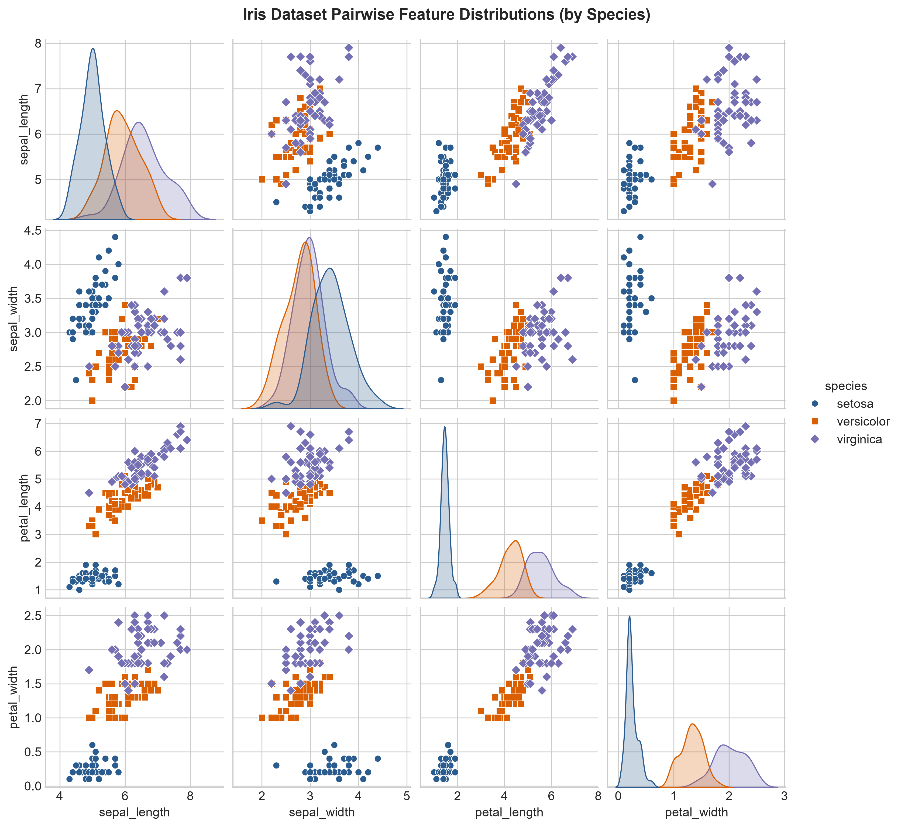
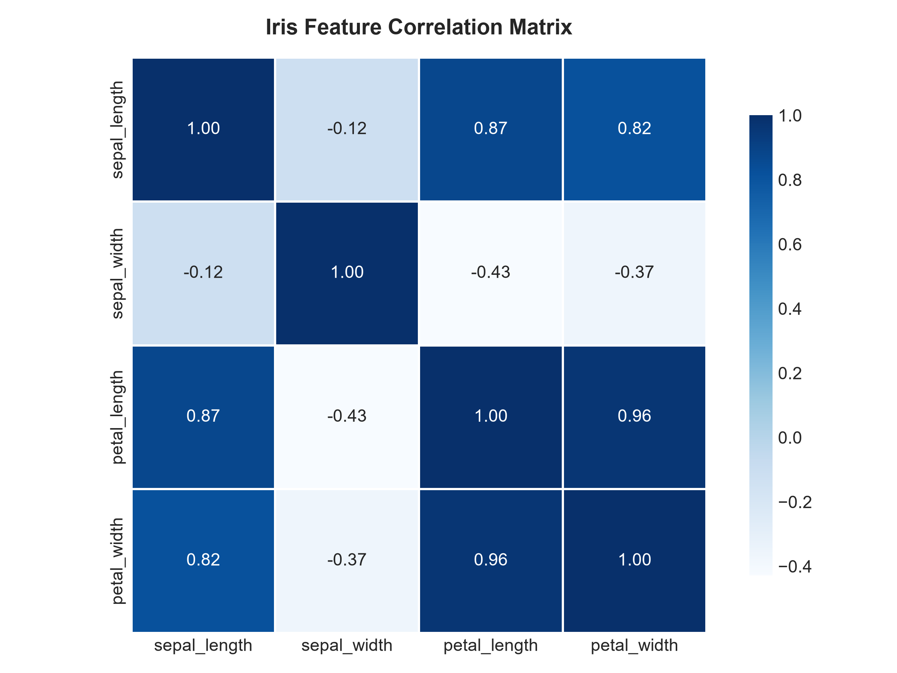
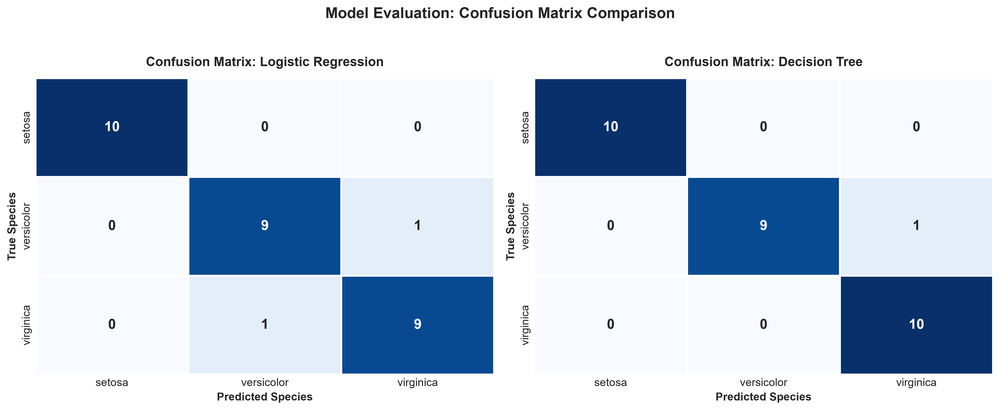
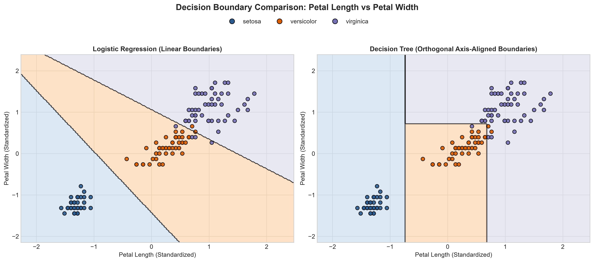
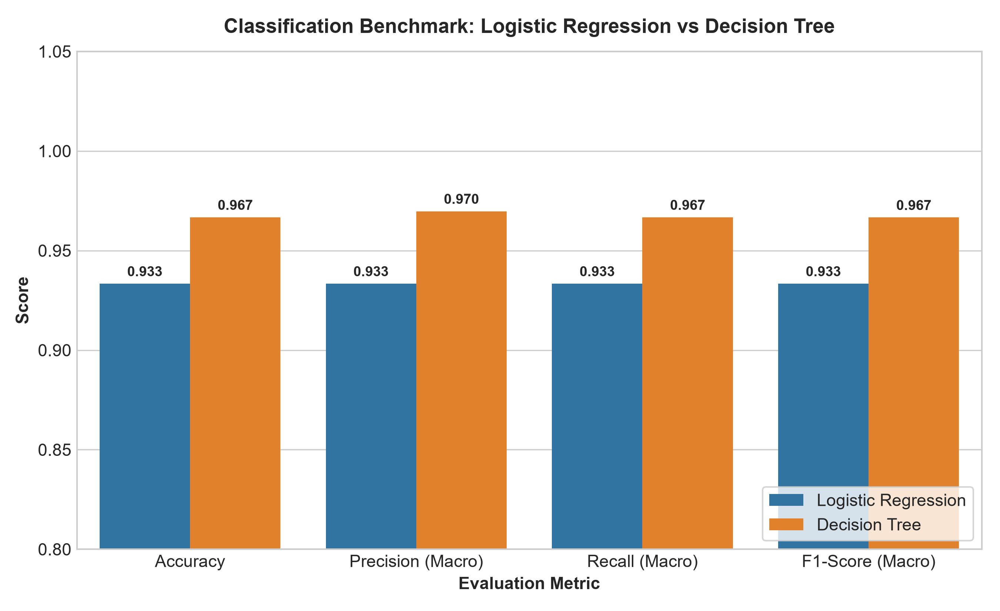
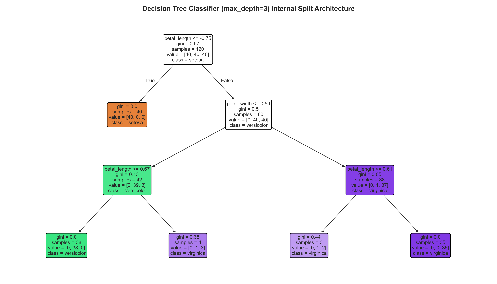

# 🌸 Multi-Class Benchmark Classification Pipeline (Iris Dataset)
### 🚀 End-to-End Supervised Machine Learning Benchmark Pipeline

[](https://www.python.org/)
[](https://scikit-learn.org/)
[](https://pandas.pydata.org/)
[](https://jupyter.org/)
[](#-benchmark-performance-summary)
[](#-license)

> **Machine Learning & Data Science Internship Task 1**: Implementation of an end-to-end supervised multi-class classification benchmark on the Iris dataset. Features rigorous data normalization (`StandardScaler`), zero-leakage stratified train/test splitting (80/20), model benchmarking (**Multinomial Logistic Regression** vs. **Decision Tree Classifier**), diagnostic confusion matrix heatmaps, and 2D decision boundary visualizations.

---

## 📑 Table of Contents
- [📌 Key Deliverables](#-key-deliverables)
- [📊 Dataset Overview](#-dataset-overview)
- [🧠 Pipeline Architecture](#-pipeline-architecture)
- [🔬 Exploratory Data Analysis (EDA)](#-exploratory-data-analysis-eda)
- [📈 Benchmark Performance Summary](#-benchmark-performance-summary)
- [📋 Detailed Classification Reports](#-detailed-classification-reports)
- [🎯 Diagnostic Visualizations & Output Screenshots](#-diagnostic-visualizations--output-screenshots)
  - [1. Confusion Matrix Comparison](#1-confusion-matrix-comparison)
  - [2. 2D Decision Boundary Topologies](#2-2d-decision-boundary-topologies)
  - [3. Benchmark Metrics Grouped Bar Chart](#3-benchmark-metrics-grouped-bar-chart)
  - [4. Decision Tree Structural Hierarchy](#4-decision-tree-structural-hierarchy)
- [🛠️ Project Directory Structure](#️-project-directory-structure)
- [⚡ Quick Start & Execution Guide](#-quick-start--execution-guide)
- [📝 Key Insights & Internship Conclusion](#-key-insights--internship-conclusion)

---

## 📌 Key Deliverables

| Deliverable | Description | Location |
| :--- | :--- | :--- |
| 📓 **Jupyter Notebook** | Primary expected deliverable with full narrative, theory, code cells, pre-computed outputs, and visualizations. | [`multi_class_benchmark_pipeline.ipynb`](./multi_class_benchmark_pipeline.ipynb) |
| 🐍 **Python Pipeline Script** | Standalone, production-grade modular pipeline script for batch and automated execution. | [`pipeline.py`](./pipeline.py) |
| 🗃️ **Benchmark Dataset** | Standardized Iris multi-class benchmark dataset (150 rows, 4 continuous features, 3 balanced species). | [`iris.csv`](./iris.csv) |
| 🖼️ **Diagnostic Figures** | Publication-grade 300 DPI visualizations for confusion matrices, decision boundaries, and EDA. | [`figures/`](./figures/) |

---

## 📊 Dataset Overview

The dataset corresponds to Fisher's classic **Iris Benchmark Dataset**, containing 150 biological specimens across 3 botanical species:
* `setosa` ($n=50$)
* `versicolor` ($n=50$)
* `virginica` ($n=50$)

| Feature | Type | Units | Description |
| :--- | :---: | :---: | :--- |
| `sepal_length` | Continuous | cm | Length of the floral sepal |
| `sepal_width` | Continuous | cm | Width of the floral sepal |
| `petal_length` | Continuous | cm | Length of the floral petal |
| `petal_width` | Continuous | cm | Width of the floral petal |
| `species` | Categorical | target | Class label (`setosa`, `versicolor`, `virginica`) |

* **Data Integrity**: 0 missing values, complete numerical matrix, perfectly balanced class distribution ($1:1:1$).

---

## 🧠 Pipeline Architecture

```
                                 ┌─────────────────────────┐
                                 │      iris.csv Data      │
                                 │  (150 rows x 4 features)│
                                 └────────────┬────────────┘
                                              │
                                              ▼
                                 ┌─────────────────────────┐
                                 │   Exploratory Analysis  │
                                 │  (Pairplots, Heatmaps)  │
                                 └────────────┬────────────┘
                                              │
                                              ▼
                                 ┌─────────────────────────┐
                                 │ Stratified Split (80/20)│
                                 │ Train: 120  |  Test: 30 │
                                 └────────────┬────────────┘
                                              │
                                              ▼
                                 ┌─────────────────────────┐
                                 │     StandardScaler      │
                                 │ (Fitted strictly on     │
                                 │  Train to prevent leak) │
                                 └──────┬────────────┬─────┘
                                        │            │
                    ┌───────────────────┘            └──────────────────┐
                    ▼                                                   ▼
     ┌─────────────────────────────┐                     ┌─────────────────────────────┐
     │ Logistic Regression (L-BFGS)│                     │ Decision Tree (CART, Gini)  │
     │ - Multinomial Cross-Entropy │                     │ - max_depth=3 Regularization│
     │ - L2 Regularization (C=1.0) │                     │ - Axis-aligned partitions   │
     └──────────────┬──────────────┘                     └──────────────┬──────────────┘
                    │                                                   │
                    └───────────────────┬───────────────────────────────┘
                                        │
                                        ▼
                         ┌─────────────────────────────┐
                         │   Comprehensive Benchmark   │
                         │ - Accuracy, Precision,      │
                         │   Recall, F1-Score          │
                         │ - Confusion Matrix Heatmaps │
                         │ - 2D Decision Boundaries    │
                         └─────────────────────────────┘
```

### Methodological Principles:
1. **Zero Data Leakage:** The `StandardScaler` standardizes features according to $z = \frac{x - \mu}{\sigma}$. Parameters $\mu$ and $\sigma$ are calculated solely on the 80% training set (`fit_transform`) and applied out-of-sample on the 20% test set (`transform`).
2. **Stratified Sampling:** Enforces exact $10:10:10$ distribution in the test partition using `stratify=y`, guaranteeing zero sampling bias.

---

## 🔬 Exploratory Data Analysis (EDA)

<div align="center">

### Feature Interactions & Pairwise Separability


</div>

* **Key Observation:** `setosa` is strictly linearly separable from `versicolor` and `virginica` solely by thresholding `petal_length` ($< 2.0\text{ cm}$).
* `versicolor` and `virginica` exhibit slight morphological overlap, serving as a clean test for linear boundary vs. non-linear decision tree partitions.

<div align="center">

### Pearson Feature Correlation Matrix


</div>

* `petal_length` and `petal_width` exhibit an exceptionally strong collinear correlation ($r = 0.963$), explaining why these two features serve as the most potent discriminators for multi-class classification.

---

## 📈 Benchmark Performance Summary

All models were evaluated on the held-out test partition ($n=30$, strictly balanced with 10 samples per class):

| Metric | Logistic Regression | Decision Tree Classifier | Delta / Winner |
| :--- | :---: | :---: | :---: |
| **Accuracy** | `0.9333` (93.33%) | **`0.9667` (96.67%)** | 🏆 **Decision Tree (+3.34%)** |
| **Precision (Macro)** | `0.9333` | **`0.9697`** | 🏆 **Decision Tree** |
| **Recall (Macro)** | `0.9333` | **`0.9667`** | 🏆 **Decision Tree** |
| **F1-Score (Macro)** | `0.9333` | **`0.9666`** | 🏆 **Decision Tree** |
| **Precision (Weighted)** | `0.9333` | **`0.9697`** | 🏆 **Decision Tree** |
| **Recall (Weighted)** | `0.9333` | **`0.9667`** | 🏆 **Decision Tree** |
| **F1-Score (Weighted)** | `0.9333` | **`0.9666`** | 🏆 **Decision Tree** |

---

## 📋 Detailed Classification Reports

### 🔹 Logistic Regression
```text
              precision    recall  f1-score   support

      setosa     1.0000    1.0000    1.0000        10
  versicolor     0.9000    0.9000    0.9000        10
   virginica     0.9000    0.9000    0.9000        10

    accuracy                         0.9333        30
   macro avg     0.9333    0.9333    0.9333        30
weighted avg     0.9333    0.9333    0.9333        30
```

### 🔹 Decision Tree Classifier
```text
              precision    recall  f1-score   support

      setosa     1.0000    1.0000    1.0000        10
  versicolor     1.0000    0.9000    0.9474        10
   virginica     0.9091    1.0000    0.9524        10

    accuracy                         0.9667        30
   macro avg     0.9697    0.9667    0.9666        30
weighted avg     0.9697    0.9667    0.9666        30
```

---

## 🎯 Diagnostic Visualizations & Output Screenshots

### 1. Confusion Matrix Comparison
Side-by-side Seaborn confusion matrix heatmaps highlighting exact sample distributions, True Positives (diagonal), and cross-class confusions:

<div align="center">
  
</div>

* **Setosa:** $10/10$ accurately predicted with zero confusion in both models.
* **Versicolor & Virginica:** Logistic regression had 1 symmetrical error each (1 Versicolor predicted as Virginica, 1 Virginica predicted as Versicolor). The Decision Tree successfully attained **100% Recall for Virginica** ($10/10$ correct).

---

### 2. 2D Decision Boundary Topologies
Visualizing decision surface boundaries in standardized 2D subspace (`petal_length` vs. `petal_width`):

<div align="center">
  
</div>

* **Logistic Regression:** Partitions space with smooth linear hyperplanes determined by equal posterior class probabilities.
* **Decision Tree:** Partitions space into orthogonal, axis-aligned rectangular boxes using hierarchical single-feature threshold cuts.

---

### 3. Benchmark Metrics Grouped Bar Chart
Comprehensive multi-metric side-by-side benchmarking:

<div align="center">
  
</div>

---

### 4. Decision Tree Structural Hierarchy
Complete visualization of the trained Decision Tree architecture (`max_depth=3`) displaying Gini impurity, sample counts, and class majorities at each split:

<div align="center">
  
</div>

---

## 🛠️ Project Directory Structure

```plaintext
d:/multiclass_benchmark_classification_pineline/
├── figures/                                    # Generated 300 DPI visual figures
│   ├── benchmark_metrics_comparison.png        # Bar chart comparing accuracy, precision, recall, F1
│   ├── confusion_matrices.png                  # Side-by-side Seaborn confusion matrix heatmaps
│   ├── decision_boundaries.png                 # 2D decision boundary visualization
│   ├── decision_tree_structure.png             # Visual graph of Decision Tree nodes & splits
│   ├── eda_correlation_matrix.png              # Feature correlation matrix heatmap
│   └── eda_pairplot.png                        # Seaborn pairplot with KDE marginal distributions
├── iris.csv                                    # Ingested benchmark dataset (150 rows)
├── multi_class_benchmark_pipeline.ipynb        # Primary Deliverable: Self-contained Jupyter Notebook
├── pipeline.py                                 # Production Python pipeline script
└── README.md                                   # Comprehensive project documentation
```

---

## ⚡ Quick Start & Execution Guide

### Prerequisites
Install all required scientific libraries:
```bash
pip install numpy pandas scikit-learn matplotlib seaborn jupyter nbformat nbclient
```

### Running the Jupyter Notebook (Primary Deliverable)
Open the fully pre-executed notebook in your preferred environment (VS Code, JupyterLab, Jupyter Notebook, or Google Colab):
```bash
jupyter notebook multi_class_benchmark_pipeline.ipynb
```
*All cells are already executed with outputs, tables, and plots pre-rendered.*

### Running via Python Script
To execute the automated pipeline from the terminal and regenerate all figures:
```bash
python pipeline.py
```

---

## 📝 Key Insights & Internship Conclusion

1. **Feature Dominance:** Petal measurements (`petal_length` and `petal_width`) contain almost all necessary discriminant variance for classifying Iris species, demonstrating $r = 0.963$ collinearity.
2. **Model Trade-Offs:**
   - **Logistic Regression (93.33%):** Highly robust, linear decision boundaries, directly outputs probabilistic confidences.
   - **Decision Tree (96.67%):** Superior separation on the non-linear boundary between Versicolor and Virginica, with direct if-else rule interpretability.
3. **Data Preprocessing Impact:** Applying `StandardScaler` strictly on the training partition prevented data leakage while ensuring optimal numerical convergence for the gradient-based L-BFGS solver in Logistic Regression.

---

## 📜 License
Distributed under the **MIT License**. Created as part of the Machine Learning & Data Science Internship Program.
